# PEMROGRAMAN BERORIENTASI OBJEK

## Biodata

- Muhammad Rafif Akbar
- 4525210125
- Teknik Informatika

## Materi Pembelajaran

1. Class dan Object
2. Encapsulation dan Constructor
3. Inheritance dan Method Overriding
4. Polimorfisme
5. Asosiasi, Agregasi, dan Komposisi
6. Abstract Class dan Interface

---

## Tugas 01 - Class dan Object

### Deskripsi Tugas

Program ini menggunakan class `iPhone` sebagai cetak biru object. Dua object
iPhone dibuat dengan warna dan kapasitas penyimpanan yang berbeda, kemudian
informasinya ditampilkan melalui method `getColor()` dan `getStorage()`.

### Screenshot Hasil Run

#### Hasil Run Java

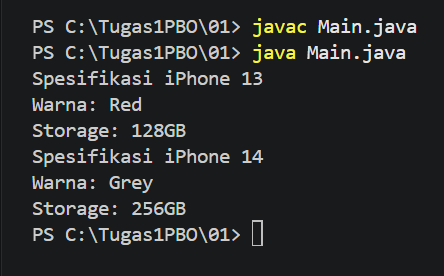

#### Hasil Run PHP

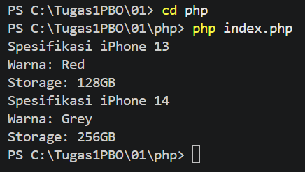

---

## Tugas 02 - Encapsulation dan Constructor

### Deskripsi Tugas

Program ini menerapkan encapsulation pada class `Mahasiswa`. Property
`nama`, `nim`, dan `umur` dibuat `private`, sehingga akses dan perubahan data
dilakukan melalui getter dan setter.

### Screenshot Hasil Run

#### Hasil Run Java

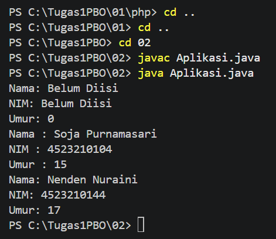

#### Hasil Run PHP

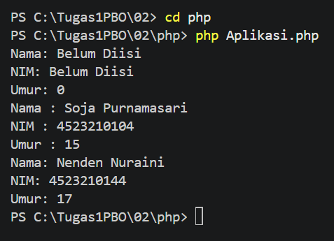

---

## Tugas 03 - Inheritance dan Method Overriding

### Deskripsi Tugas

Program ini menerapkan inheritance dan method overriding melalui dua contoh.
Class `BangunDatar` diwarisi oleh `Lingkaran`, `Persegi`, dan `Segitiga`.
Selain itu, class `MahasiswaInternational` mewarisi class `Mahasiswa`.

### Screenshot Hasil Run

#### Hasil Run Java

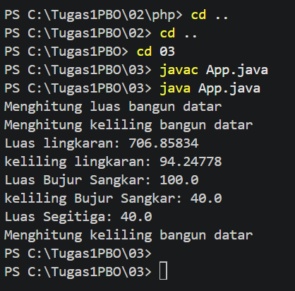

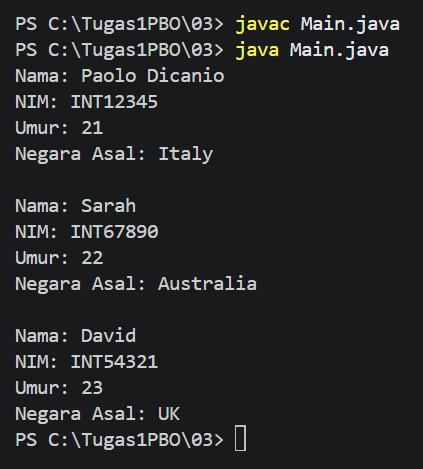

#### Hasil Run PHP

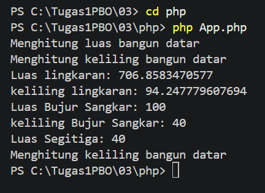

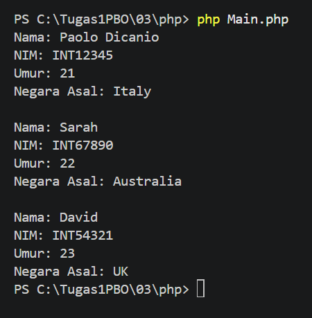

---

## Tugas 04 - Inheritance dan Polimorfisme

### Deskripsi Tugas

Program ini menerapkan inheritance dan polimorfisme pada class `Handphone`.
Class `Smartphone` dan `FeaturePhone` mewarisi `Handphone`, kemudian
mengubah perilaku method `nyalakan()`, `matikan()`, dan `telepon()`.

### Screenshot Hasil Run

#### Hasil Run Java

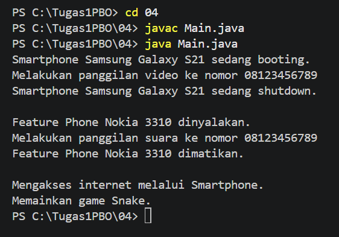

#### Hasil Run PHP

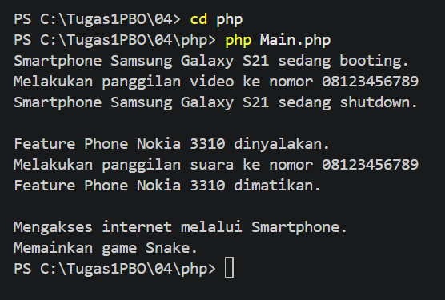

---

## Tugas 05 - Asosiasi, Agregasi, dan Komposisi

### Deskripsi Tugas

Program ini menerapkan hubungan antar-object menggunakan tiga jenis relasi,
yaitu asosiasi, agregasi, dan komposisi.

### Screenshot Hasil Run

#### Hasil Run Java

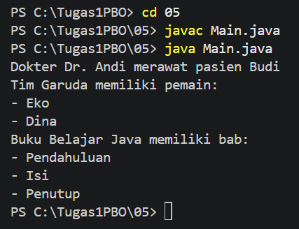

#### Hasil Run PHP

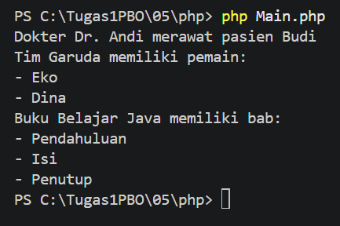

---

## Tugas 06 - Abstract Class dan Interface

### Deskripsi Tugas

Program ini menerapkan abstract class dan interface. Abstract class `Vehicle`
menjadi parent class untuk berbagai jenis kendaraan, sedangkan interface
`Movable` dan `Fuelable` menentukan kemampuan yang dapat dimiliki object.

### Screenshot Hasil Run

#### Hasil Run Java

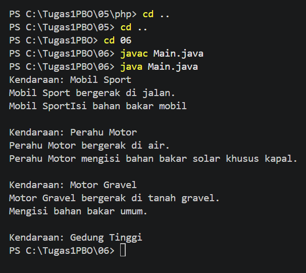

#### Hasil Run PHP

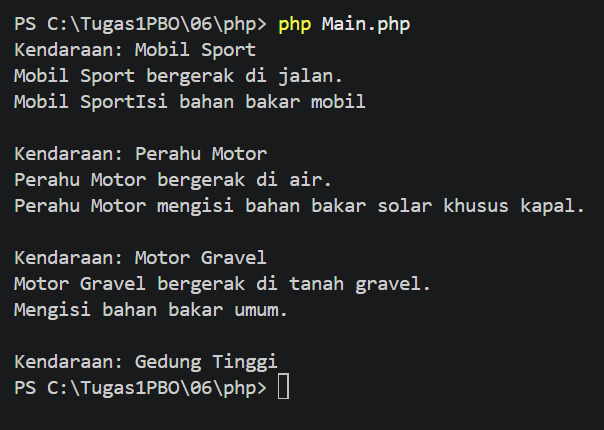
